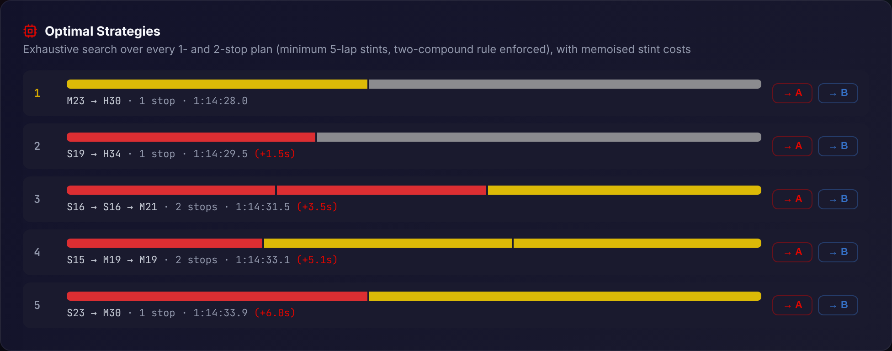
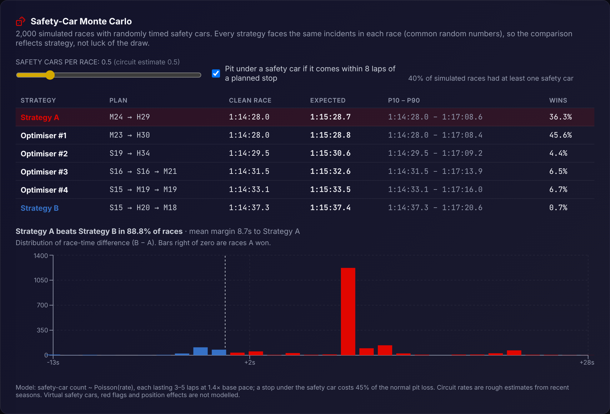

# F1 Strategy Hub

[**Live site →**](https://rifatibnalam.github.io/f1-strategy-hub/) · [**Offline demo →**](https://rifatibnalam.github.io/f1-strategy-hub/?demo) (serves a bundled data snapshot, no live APIs needed)

F1 Strategy Hub is a Formula 1 analytics app built on real timing data. It pairs a React dashboard (live standings, telemetry, race analysis) with a lap-by-lap race strategy model, plus Python scripts for deeper FastF1 analysis.

## Highlights



- **Model calibrated on real races, with a backtest.** A fixed-effects least-squares regression over every clean lap of a race estimates compound pace, tyre wear and the combined fuel/track gain. The car+driver effect is separated out, so a fast car on hards doesn't make hards look quick. Pit loss is measured from in-lap and out-lap times. The fit is then scored **out of sample** on the same circuit's race a season later, against a per-driver-median baseline. Finally it compares the winner's actual strategy with the model's optimum.
- **Monte Carlo safety cars.** 2,000 simulated races with Poisson-distributed safety cars and an optional "pit under SC" reaction policy, using common random numbers across strategies. The output is expected race time, P10–P90 spread and win probability per strategy, and a flag when uncertainty changes the best choice.
- **Strategy optimiser.** Exhaustively searches every legal 1- and 2-stop plan (~30k candidates, memoised stint costs) and ranks the fastest. Any result can be loaded into the side-by-side simulator.
- **Explainable lap-time model.** Compound pace offsets, linear wear plus a compound-specific performance cliff, fuel burn, track evolution and per-circuit pit loss. The model enforces race distance and the two-compound rule.
- **Real car telemetry.** Speed, throttle, brake and gear traces for any lap, with distance integrated from OpenF1's ~3.7 Hz `car_data`, plus synced cursors across channels.
- **Real tyre degradation.** Per-stint least-squares fits with outlier filtering, true tyre age (including used sets), and fuel-corrected degradation rates.
- **Undercut/overcut detection.** On-track gaps come from line-crossing timestamps rather than summed lap times, so a missing lap can't skew the result.
- **Works offline.** CI snapshots live API responses at build time (and weekly). If OpenF1 or Jolpica fail, the app transparently serves saved data and says so; `?demo` forces offline mode for live demos.
- **Live championship.** Standings, calendar with a next-race countdown, last result. Head-to-head driver comparison includes sprint points, the actual starting grid and correct DNF classification.
- **Race position flow.** Lap-by-lap bump chart sized to the field (22 cars from 2026), with pit-lane starts handled.
- **Championship history.** Every title since 1950, dynasty streaks, eras and verified records.

## Engineering notes

- **Data correctness.** Team colours resolve from Jolpica ids, Jolpica names or OpenF1 names (2026 grid, including Audi and Cadillac) and prefer OpenF1's official `team_colour`. Mid-season transfers use the driver's latest team. Teammates get a contrasting colour in two-driver charts.
- **Resilient data layer.** In-memory caching with TTLs, exponential back-off on HTTP 429 for both APIs, and a `useApi` hook that drops stale responses and clears data when a selection is reset.
- **Robust UI.** An error boundary per view, hash routing for shareable links (`#/strategy`) that works on GitHub Pages, and safe `localStorage` access.
- **Snapshot layer.** `scripts/snapshot.mjs` runs the app's own service modules under Node, so the recorded URLs are byte-for-byte the ones the browser requests. It is rate-limited per host and never fails the build.
- **Tests.**
  - 41 Jest unit tests: the regression recovers known parameters from a synthetic race, the backtest beats its baseline out of sample, the Monte Carlo is reproducible and splits ties, plus the strategy model, optimiser and data helpers.
  - A Playwright end-to-end suite drives every view against deterministic API fixtures. It also checks the API-down fallback, that `?demo` makes zero live requests, and that no page scrolls horizontally at phone width.
  - Unit and e2e tests both gate every deploy.

## Stack

- Frontend: React 18, Recharts, Lucide React
- Analysis: Python 3.10+, FastF1, Pandas, NumPy, Matplotlib, SciPy
- Data: [OpenF1](https://openf1.org) (2023+, sessions, laps, stints, car telemetry), [Jolpica F1](https://github.com/jolpica/jolpica-f1) (1950+, results, standings, schedules, lap positions), [FastF1](https://docs.fastf1.dev) (Python)

## Project structure

```text
f1-strategy-hub/
├── frontend/
│   ├── e2e/              # Playwright suite + deterministic API fixtures
│   ├── scripts/          # Build-time API snapshot
│   └── src/
│       ├── components/   # One component per view, plus shared widgets
│       ├── models/       # Strategy model, optimiser, calibration, Monte Carlo (pure, unit-tested)
│       ├── services/     # OpenF1 and Jolpica clients + offline snapshot fallback
│       ├── hooks/        # useApi
│       └── data/         # Team colours, flags, championship history
├── analysis/
│   ├── scripts/          # FastF1 telemetry, race pace, qualifying gap scripts
│   └── requirements.txt
└── .github/workflows/    # Test + build + deploy to GitHub Pages
```

## Strategy model

```
lapTime = basePace + compoundOffset + degRate × tyreAge + cliffPenalty
        + fuelEffect × fuelOnBoard + trackEvolution × (lap − 1)
```

Each pit stop adds the circuit's pit-lane loss. On top of this deterministic model:

- **Calibration** replaces the default compound parameters with values fitted to a real race (`src/models/calibration.js`):

  ```
  lapTime = driverPace[d] + compoundOffset[c] + wear[c] × tyreAge + k × (lap − 1)
  ```

  Fuel burn and track evolution are collinear in timing data, so `k` captures both. The simulator splits it back out using its assumed fuel effect.
- **Monte Carlo** (`src/models/montecarlo.js`) adds safety cars: count ~ Poisson(circuit rate), 3–5 laps each at 1.4× base pace, and a stop under SC costs 45% of normal pit loss.



 Parameters are representative values tuned to published Pirelli/FIA ranges, not team data. The point is to reproduce real trade-offs: medium→hard one-stops at Monza and Silverstone, two-stops at high-degradation tracks. The model ignores traffic and overtaking difficulty, so it will happily recommend a Monaco two-stop that track position would never allow.

## Getting started

```bash
cd frontend
npm install
npm start          # http://localhost:3000
npm test           # unit tests
npm run snapshot:mock && npm run build && npm run e2e   # end-to-end suite (offline fixtures)
npm run snapshot   # capture live API data into public/snapshot/ (as CI does)
```

Python analysis:

```bash
cd analysis
pip install -r requirements.txt
python scripts/telemetry_analysis.py --year 2025 --race "Monza" --drivers NOR PIA LEC
python scripts/race_pace_model.py --year 2025 --race "Monza" --driver NOR
python scripts/qualifying_gap_analysis.py --year 2025 --races 10
```

Figures are written to `docs/images/`, and FastF1 caches data in `analysis/cache/`.

## Deployment

Pushing to `main` runs the unit and end-to-end tests, snapshots live API data, builds the app and deploys it to GitHub Pages via `.github/workflows/deploy-pages.yml`. A weekly scheduled run refreshes the snapshot after race weekends. Pull requests run everything except the deploy.

## Notes

- API-backed views depend on OpenF1 and Jolpica availability and rate limits. OpenF1 data starts in 2023.
- OpenF1 telemetry is sampled at ~3.7 Hz, so traces are smoother than team data and integrated distance can drift slightly from the official lap length.

## License

MIT. See [LICENSE](LICENSE).
